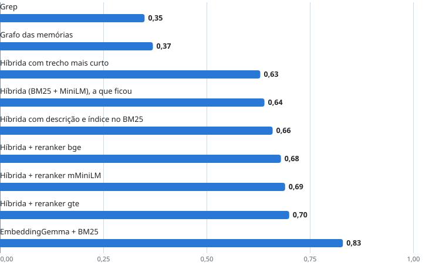
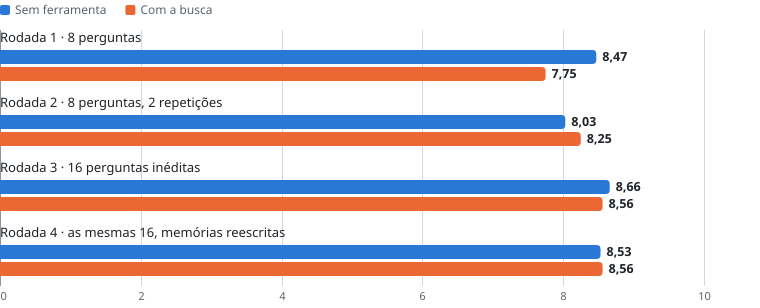
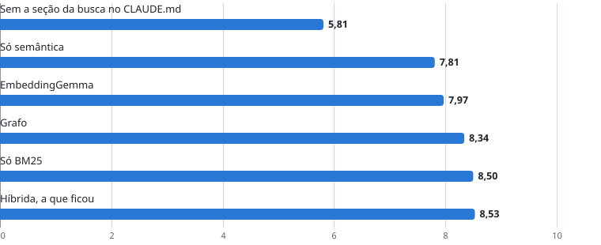
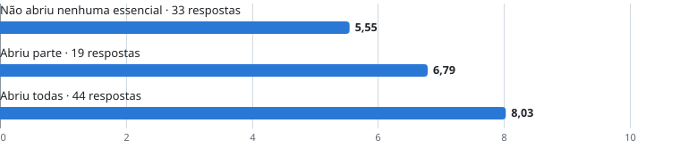
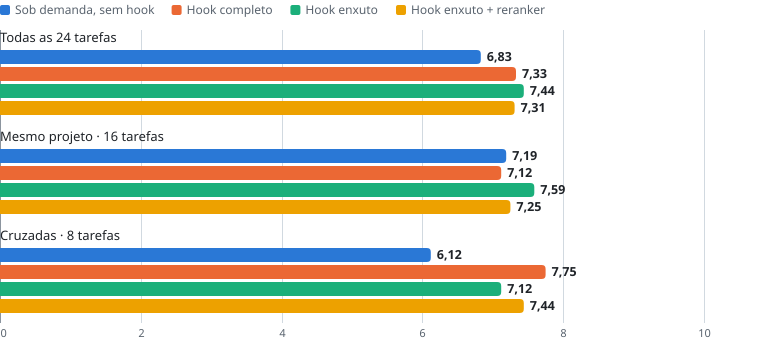
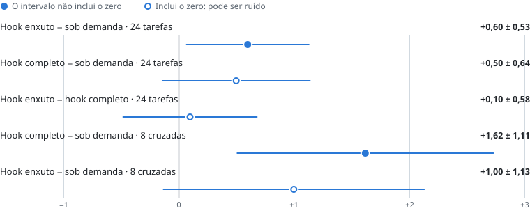
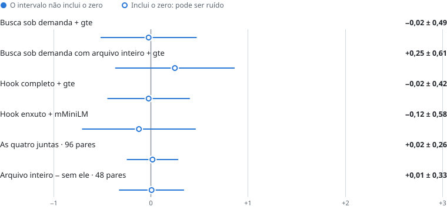
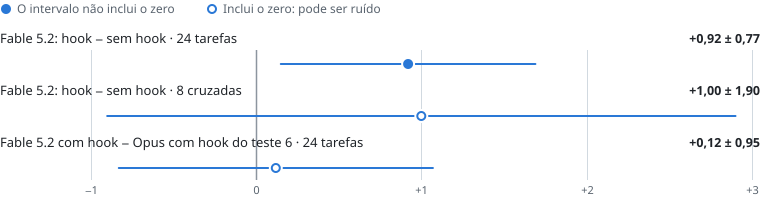

# Estudo de caso: como o Claude Code usa, e não usa, as próprias memórias

*Nove testes · novembro de 2026 · um acervo de 170 memórias*

Nove testes sobre as memórias do Claude Code. Uma busca que recupera quase o dobro das memórias certas não mudou a nota das respostas. O único efeito distinguível de zero veio de entregar o resultado da busca sem o agente pedir. Ele reapareceu com um segundo modelo, e o tamanho continua incerto. Abaixo, o que sustenta cada conclusão e o que a enfraquece.

| Medida | O que é |
|---|---|
| **0,64 × 0,35** | Fração das memórias essenciais recuperadas: busca híbrida contra grep, em 42 perguntas. |
| **8,56 × 8,66** | Nota das respostas com a busca e sem ela. Não distinguíveis com 16 perguntas. |
| **+0,60 ± 0,53** | Busca entregue sem o agente pedir, em 24 tarefas. Com um segundo modelo, +0,92 ± 0,77. |

## Sumário

- [O problema](#o-problema)
- [Como foi medido](#como-foi-medido)
- [O que as 24 tarefas pediam](#o-que-as-24-tarefas-pediam)
- [Como a nota é dada](#como-a-nota-é-dada)
- [Como os agentes rodaram](#como-os-agentes-rodaram)
- [Como ler estes resultados](#como-ler-estes-resultados)
- [Qual busca recupera mais memórias essenciais](#qual-busca-recupera-mais-memórias-essenciais)
- [A busca muda a resposta a perguntas?](#a-busca-muda-a-resposta-a-perguntas)
- [De onde vinham as respostas erradas](#de-onde-vinham-as-respostas-erradas)
- [O agente usa a busca se ninguém avisar que ela existe?](#o-agente-usa-a-busca-se-ninguém-avisar-que-ela-existe)
- [Reranker e arquivo inteiro mudam a resposta em tarefas reais?](#reranker-e-arquivo-inteiro-mudam-a-resposta-em-tarefas-reais)
- [E se a busca chegar sem o agente pedir?](#e-se-a-busca-chegar-sem-o-agente-pedir)
- [O reranker vale o custo?](#o-reranker-vale-o-custo)
- [Quanto custa rodar a busca a cada pedido](#quanto-custa-rodar-a-busca-a-cada-pedido)
- [O efeito do hook aparece com outro modelo?](#o-efeito-do-hook-aparece-com-outro-modelo)
- [O que ficou e o que saiu](#o-que-ficou-e-o-que-saiu)
- [O que os testes não medem](#o-que-os-testes-não-medem)
- [O que eu mediria a seguir](#o-que-eu-mediria-a-seguir)

## O problema

O Claude Code guarda memórias em arquivos de texto, um fato por arquivo: decisões, pegadinhas, o estado de cada frente de trabalho. Uso em vários projetos, e o acervo passou de 170 memórias.

O agente encontra essas memórias por um índice e por grep. A suspeita era que ele não achava a memória certa quando a pergunta usava palavras diferentes das do arquivo. Construí uma busca que procura por palavra e por sentido, roda local e não chama nenhum modelo de linguagem, e fui medir se ela ajudava.

A resposta curta é que recuperar melhor não bastou. A longa depende de quanto se confia em cada medida, e por isso cada teste abaixo traz o que os dados mostram e, em separado, a ressalva.

## Como foi medido

Houve dois tipos de teste. No primeiro, só a busca roda: 42 perguntas com gabarito, e a medida é a fração das memórias essenciais que aparece entre os 10 primeiros resultados. No segundo, um agente (Claude Opus) responde e outro Opus dá nota de 0 a 10 sem saber de qual variante veio cada resposta.

Os primeiros testes com agente usaram perguntas montadas para o teste (8 ou 16). Os últimos usaram 24 pedidos reais tirados das minhas conversas: 8 de um projeto, 8 de outro e 8 gerais. Oito deles são cruzados.

O **±** é o intervalo de 95% da diferença por tarefa. Diferença menor que o ± é ruído.

- **BM25:** Busca por palavra. Acha o termo exato e não precisa de modelo.
- **Semântica:** Busca por sentido, com embeddings de um modelo local (MiniLM, 220 MB).
- **Híbrida:** As duas listas juntas, com o lado do sentido valendo o dobro.
- **Reranker:** Segundo modelo que relê os 20 ou 40 melhores trechos e reordena.
- **Hook:** Script que o Claude Code roda sozinho a cada pedido. Aqui, ele busca nas memórias e anexa a lista ao pedido, antes de o agente ler. Há um exemplo no teste 6.
- **Tarefa cruzada:** Assunto registrado num projeto, pedido de dentro de outro.
- **Memória essencial:** Memória sem a qual a pergunta não é respondida direito. O gabarito lista quais são, pergunta por pergunta.
- **Busca sob demanda:** A busca fica disponível como ferramenta, e o agente decide se e quando chama. É o contrário do hook.

## O que as 24 tarefas pediam

As tarefas reais dos testes 5, 6, 7 e 9 são pedidos que eu fiz de verdade ao agente, com o texto original, informal e com erros de digitação. Só acrescentei uma frase de contexto onde o pedido não se sustentava sozinho. São perguntas abertas, em que a resposta depende do estado do projeto ou do ambiente, e não consultas de um fato.

| Tipo de pedido | Tarefas | Exemplo |
|---|---:|---|
| Avaliar uma decisão técnica | 7 | Quanto custa o GitHub Actions e que ganho teríamos com ele? |
| Diagnosticar e corrigir | 6 | As datas aparecem em produção algumas horas depois do cadastro real. |
| Planejar ou integrar uma mudança no produto | 4 | Integrar à branch principal o que duas frentes paralelas fizeram na mesma tela. |
| Entender como algo já funciona | 4 | Com um adaptador DisplayPort eu conseguiria usar os hertz a mais do monitor? |
| Preparar uma conversa com pessoas | 3 | Um colega perguntou se o portal acessa o banco direto. Como responder bem? |

- **Origem:** 8 pedidos de um produto em produção, 8 de outro e 8 feitos fora de qualquer projeto, sobre o ambiente de trabalho.
- **Cruzadas:** em 8 delas o assunto está anotado nas memórias de um projeto e o pedido foi feito de dentro de outro.
- **Gabarito:** cada tarefa lista de 1 a 9 memórias relevantes, das quais de 1 a 6 são essenciais.
- **Critérios:** o juiz confere 4 ou 5 critérios por tarefa, escritos a partir das memórias essenciais, e conta os erros de fato.

> **Ressalva:** o agrupamento por tipo é meu e serve só para descrever o conjunto. Com 3 a 7 tarefas por tipo, não dá para dizer em qual deles a busca ajuda mais. E o conjunto reflete o meu trabalho: quase não há pedido de escrever código do zero.

## Como a nota é dada

O juiz recebe, numa chamada só, a tarefa, a lista das memórias sobre o assunto (marcadas como essenciais ou não), os critérios e todas as respostas daquela tarefa, embaralhadas e identificadas por letra. Ele não sabe de qual variante veio cada uma. A instrução manda ler os arquivos inteiros antes de avaliar e diz que os critérios são um guia: se um critério contradisser o arquivo, vale o arquivo.

Para cada resposta, o juiz devolve quatro coisas:

| O que o juiz devolve | Como | Coluna nas tabelas |
|---|---|---|
| Critérios | 1 (atende), 0,5 (em parte) ou 0 (não atende ou contradiz), um valor por critério | Critérios atendidos (média) |
| Erros | Lista das afirmações ou passos errados, ou que contradizem o que está registrado | Erros (soma) |
| Omissões | O mais importante que ficou de fora, em texto curto | Não entra em número |
| Nota | De 0 a 10 para o trabalho entregue | Nota (média) |

A nota tem uma ordem de prioridade escrita na instrução: primeiro não errar nem repetir um erro já registrado, depois aproveitar o que já se sabe, depois a utilidade prática. Nos testes com perguntas (2 a 4), no lugar dos critérios o juiz estima a cobertura, de 0 a 1: quanto do conteúdo essencial a resposta realmente traz. Citar o arquivo não conta.

Um exemplo de critérios, da tarefa do monitor: dizer que a saída USB-C do notebook não leva vídeo; dizer que o limite está na porta HDMI, e que adaptador ou cabo novo não aumentam a taxa; informar o teto atual e concluir que a compra não vale; e, se for mexer de novo, apontar os scripts que já existem em vez de propor tudo do zero.

> **Ressalva:** a nota não é calculada a partir dos critérios. É um julgamento único do juiz, com uma ordem de prioridade e sem pesos. E as respostas são avaliadas lado a lado, então a nota de uma depende em parte das outras que estão na mesma chamada. Por isso as diferenças dentro de uma rodada são mais confiáveis que a comparação de notas entre rodadas.

## Como os agentes rodaram

| Item | Configuração |
|---|---|
| Ferramenta | Claude Code em modo não interativo, numa VPS. Versão 2.1.322 em 12/11; a dos dias 9 e 10 não foi registrada. |
| Modelo do agente | Claude Opus nos testes 2 a 7. Claude Fable 5.2 no teste 9. |
| Esforço de raciocínio do agente | Médio nos testes 4 a 7 e 9. No teste 2 não foi fixado: valeu o padrão da ferramenta. |
| Juiz | Claude Opus em todos os testes com nota. Esforço alto nas tarefas reais (testes 5, 6, 7 e 9). |
| Sessão | Uma sessão nova por pedido, sem a conversa original e sem guardar histórico. |
| Onde o agente abre | Na pasta do projeto de origem do pedido, onde ele recebe o índice de memórias daquele projeto. Nos pedidos gerais, fora de qualquer projeto. |
| O que o agente pode fazer | Ler arquivos e rodar comandos. As ferramentas de editar e criar arquivo ficam bloqueadas. |
| Aviso no fim do pedido | A máquina não tem o código atual nem acesso aos servidores: responder com o que faria e por quê, sem alterar nada. |
| Como a variante fica escondida | O comando de busca tem o mesmo nome em todas as variantes; só muda o que ele faz por baixo. No hook, muda o que é posto no contexto. |
| Repetições | Uma resposta por tarefa e por variante. Só a rodada 2 do teste 2 teve duas. |
| Paralelismo | Até 6 agentes ao mesmo tempo, com limite de 20 minutos por resposta. |

O tempo médio por resposta ficou entre 29 e 37 s nos testes com perguntas e entre 29 e 39 s nas tarefas reais. O hook acrescenta de 5 a 8 s. É o tempo do agente até entregar a resposta, sem contar o juiz. Nos testes 6 e 9, cada resposta levou de 2,6 a 4 turnos em média.

> **Ressalva:** o esforço médio era o padrão das minhas sessões quando rodei os testes, e por isso foi o escolhido. Com esforço maior o agente talvez buscasse mais por conta própria, e o ganho do hook poderia encolher. Isso não foi medido. E com uma resposta só por tarefa, não dá para separar a variação do agente da variação do juiz.

## Como ler estes resultados

- **Escopo:** um acervo só, de cerca de 170 memórias, e um juiz só. O agente foi o Claude Opus em quase todos os testes; o último repete o do hook com outro modelo. Os resultados descrevem este caso.
- **Ruído:** a mesma variante muda de 0,4 a 0,6 ponto entre duas rodadas idênticas. O juiz, reavaliando as mesmas respostas em outra ordem, muda 0,4 em média.
- **"Igual" não é "sem efeito":** com 16 a 24 itens, só aparecem diferenças a partir de meio ponto. Abaixo disso, o teste não distingue.
- **Muitas comparações:** os testes 6, 7 e 9 somam 14 diferenças com intervalo. Com tantas, é plausível que um intervalo exclua o zero por acaso. Por isso o efeito do hook é lido junto com outros indicadores e com a repetição do teste 9, e não sozinho.
- **As memórias mudaram durante o estudo:** em 9/11, além de corrigir as desatualizadas (teste 3), mudei o jeito de escrevê-las: mais contexto (o que a coisa é, quando vale a pena, o que foi medido) e menos decisão pronta, trava ou proibição. Fiz isso depois de ler as recomendações da Anthropic para trabalhar com o Fable. Pelo backup diário, 62 arquivos de memória foram alterados ou criados nesse dia, e outros 22 entre 10 e 12/11. Os testes 5 a 9 rodaram com as memórias já nesse estilo. O efeito da mudança de estilo, em si, não foi medido.

*Teste 1 · só a busca · 42 perguntas*

## Qual busca recupera mais memórias essenciais

**O que foi testado:** grep, um grafo das memórias, a busca híbrida e sete variações dela, sem agente nenhum. O ruído da medida é de cerca de 0,05.

**Fração das memórias essenciais entre os 10 primeiros resultados**

De 0 a 1. Quanto maior, melhor.

<picture>
  <source media="(prefers-color-scheme: dark)" srcset="img/g1-escuro.svg">
  
</picture>

<details>
<summary>Ver os números</summary>

| Variante | Essenciais nos 10 | Tempo por consulta |
|---|---:|---:|
| Grep | 0,35 | não medido |
| Grafo das memórias | 0,37 | não medido |
| Híbrida com trecho mais curto | 0,63 | 0,1 s |
| Híbrida (a que ficou) | 0,64 | 0,1 s |
| Híbrida com descrição e índice no BM25 | 0,66 | 0,1 s |
| Híbrida + reranker bge | 0,68 | 24 s |
| Híbrida + reranker mMiniLM | 0,69 | 2,3 s |
| Híbrida + reranker gte | 0,70 | 7,3 s |
| EmbeddingGemma + BM25 | 0,83 | índice leva 12 min |

</details>

**O que os dados mostram:** a híbrida recupera 0,64 das memórias essenciais contra 0,35 do grep. As variações e os rerankers ficam a até 0,06 dela, perto do ruído. Só o EmbeddingGemma se destaca.

> **Ressalva:** o gabarito foi escrito por mim a partir das mesmas memórias, e a medida só diz o que aparece entre os 10 primeiros resultados, não se um agente usaria. O número do EmbeddingGemma é de uma medição anterior à edição das memórias, quando a híbrida marcava 0,62.

*Teste 2 · agentes · quatro rodadas*

## A busca muda a resposta a perguntas?

**O que foi testado:** o mesmo agente respondendo com e sem a busca, em quatro rodadas. Sem ela, o agente conta só com o índice e o grep. Com ela, a busca fica disponível sob demanda. A última repetiu as 16 perguntas da anterior depois de as memórias serem reescritas.

**Nota do juiz, de 0 a 10**

<picture>
  <source media="(prefers-color-scheme: dark)" srcset="img/g2-escuro.svg">
  
</picture>

| Rodada | Tokens sem ferramenta | Tokens com a busca | Diferença | Tempo sem e com |
|---|---:|---:|---:|---:|
| Rodada 2 | 300 mil | 225 mil | −25% | 37 s e 31 s |
| Rodada 3 | 242 mil | 172 mil | −29% | 31 s e 29 s |
| Rodada 4 | 258 mil | 209 mil | −19% | 31 s e 30 s |

**O que os dados mostram:** as notas com e sem a busca não se distinguem em nenhuma das quatro rodadas, e a queda da rodada 1 não se repetiu. O que muda é o custo: de 19% a 29% menos tokens. Na rodada 3, o EmbeddingGemma tirou 8,56, igual ao MiniLM.

Uma explicação compatível com os dados é que o agente compensa a ferramenta mais fraca. Numa das rodadas, sem a busca ele abriu 25 a 26 das 27 memórias essenciais; com ela, 22 a 24. Ele chega às mesmas memórias lendo mais, e paga em tokens.

Antes de rodar a segunda rodada escrevi a regra de decisão: adotar a busca se a nota ficasse a até 0,4 ponto da condição sem ferramenta e com erros iguais ou menores. Ela passou na nota (8,25 contra 8,03) e não nos erros (13 contra 10). O critério de erros se mostrou instável: a mesma variante teve 9 erros numa repetição e 4 na outra.

> **Ressalva:** com notas perto de 8,5 em 10 há pouco espaço para subir, e com 16 perguntas o teste só enxerga diferenças a partir de meio ponto. O resultado é "não distinguível nesta amostra". Se eu tivesse parado na rodada 1, teria concluído que a busca piorava as respostas.

*Teste 3 · origem dos erros*

## De onde vinham as respostas erradas

**O que foi testado:** cada erro apontado pelo juiz foi classificado pela causa. A classificação é minha e não foi às cegas.

- **14 de 34** erros de uma rodada vinham de memória contradita por outra mais nova (41%). Quase sempre a descrição ou a linha do índice ainda mostrava o estado velho.
- **2 de 23** erros da rodada seguinte tinham essa causa, depois de 14 memórias serem reescritas para o estado atual.
- **0** erros por regra rígida demais. As respostas que erraram por regra aplicaram a regra fora do caso dela.

Um exemplo: uma memória dizia que uma atualização de versão estava pendente quando ela já estava em produção havia uma semana. Uma sessão grava a memória nova e não volta na antiga. Marcar a antiga como "superada" não resolve, porque o texto velho continua no arquivo e é lido como atual.

**O que os dados mostram:** depois da reescrita, os erros atribuídos a memória velha foram de 14 em 34 para 2 em 23. A nota não mudou (8,53 a 8,56). Passei a reescrever a memória antiga, com data e alcance, e a deixar o histórico no controle de versão.

> **Ressalva:** a classificação das causas é minha e foi feita sabendo de qual variante vinha cada resposta. As contagens são pequenas, e o próprio juiz oscila: as mesmas respostas tiveram 22 erros numa avaliação e 34 em outra. A queda aponta numa direção; não mede um tamanho. E a reescrita desse dia não foi só atualização de estado: ela também mudou o estilo das memórias, de regra para contexto.

*Teste 4 · agentes · 16 perguntas*

## O agente usa a busca se ninguém avisar que ela existe?

**O que foi testado:** o agente aberto fora de qualquer projeto, onde não recebe o índice de memórias, com cinco motores de busca. Uma das variantes ficou sem a seção que apresenta a busca no `CLAUDE.md`, o arquivo de instruções que o agente lê ao abrir. Depois, o mesmo dentro da pasta do projeto.

**Nota por motor de busca, agente aberto fora do projeto**

<picture>
  <source media="(prefers-color-scheme: dark)" srcset="img/g4-escuro.svg">
  
</picture>

| Variante | Nota | Erros em 16 respostas |
|---|---:|---:|
| Sem a seção da busca no `CLAUDE.md` | 5,81 | 13 |
| Só semântica | 7,81 | 11 |
| EmbeddingGemma | 7,97 | 11 |
| Grafo | 8,34 | 6 |
| Só BM25 | 8,50 | 3 |
| Híbrida (a que ficou) | 8,53 | 4 |

| Dentro da pasta do projeto | Nota | Erros |
|---|---:|---:|
| Sem a seção da busca | 7,84 | 14 |
| Só a seção da busca | 8,44 | 4 |
| `CLAUDE.md` completo | 8,47 | 5 |

**O que os dados mostram:** sem a seção que apresenta a busca, a nota fora do projeto cai para 5,81, contra 8,5 com ela. Dentro da pasta do projeto o índice já resolve boa parte: só 4 de 16 agentes usaram a busca.

> **Ressalva:** a queda para 5,81 é grande demais para ser ruído. A ordem entre os motores não é: BM25 e híbrida empatam, e os 0,5 a 0,7 ponto que separam deles a semântica pura e o EmbeddingGemma vêm de uma rodada só, perto do limite do que o teste distingue.

*Teste 5 · agentes · 24 tarefas reais*

## Reranker e arquivo inteiro mudam a resposta em tarefas reais?

**O que foi testado:** quatro versões da busca sob demanda nas mesmas 24 tarefas, com o agente sem saber qual usava: como está, com um reranker, devolvendo inteiros os dois primeiros arquivos em vez de trechos, e as duas mudanças juntas. As respostas são planos ou diagnósticos, porque a máquina de teste não tinha o código atual dos projetos nem acesso aos servidores.

| Variante | Nota | Critérios atendidos | Erros | Tempo | Agentes que buscaram |
|---|---:|---:|---:|---:|---:|
| Busca sob demanda, como está | 6,94 | 69% | 22 | 31 s | 4 de 24 |
| Com reranker gte | 6,92 | 68% | 28 | 37 s | 6 de 24 |
| 2 primeiros arquivos inteiros | 6,81 | 66% | 28 | 32 s | 5 de 24 |
| As duas juntas | 7,06 | 70% | 27 | 36 s | 5 de 24 |

**Nota conforme o agente abriu as memórias essenciais da tarefa**

96 respostas, todas as variantes juntas.

<picture>
  <source media="(prefers-color-scheme: dark)" srcset="img/g5-escuro.svg">
  
</picture>

<details>
<summary>Ver os números</summary>

| Abriu as essenciais? | Respostas | Nota | Erros por resposta |
|---|---:|---:|---:|
| Nenhuma | 33 | 5,55 | 1,9 |
| Parte | 19 | 6,79 | 1,1 |
| Todas | 44 | 8,03 | 0,5 |

</details>

**O que os dados mostram:** as quatro versões não se distinguem. Só uns 20% das respostas chegaram a usar a busca, então qualquer melhoria nela alcança poucas respostas. Há uma associação forte entre abrir as memórias essenciais e a nota: 5,55 para quem não abriu nenhuma, 8,03 para quem abriu todas. Nas cruzadas, quem buscou tirou 7,65 e quem não buscou tirou 5,32, e 22 de 32 respostas não buscaram.

> **Ressalva:** associação não é efeito. Uma tarefa mais fácil pode levar o agente a achar a memória e também a responder bem, e os critérios do juiz saem das próprias memórias, o que favorece por construção quem as abriu. A hipótese de que o gargalo é o agente não ir buscar precisa de uma intervenção para ser testada. É o teste seguinte.

*Teste 6 · agentes · mesmas 24 tarefas*

## E se a busca chegar sem o agente pedir?

**O que foi testado:** até aqui o agente decidia se chamava a busca. Agora um hook faz a busca sozinho, com o texto do pedido, e põe o resultado no contexto antes de o agente começar. Na versão completa vão os trechos de 6 resultados (5,5 KB). Na enxuta vão só o caminho e o resumo dos 5 primeiros arquivos (1,7 KB). As respostas sem hook e com o hook completo são das rodadas da véspera; as do hook enxuto são da manhã seguinte. O juiz avaliou as quatro juntas.

Na prática, o hook é um script que o Claude Code roda sozinho toda vez que um pedido é enviado, antes de o agente ler. Ele pega o texto do pedido, busca nas memórias e anexa o resultado. Quem pede não vê nada; o agente recebe o pedido já acompanhado da lista. Abaixo, um exemplo no formato enxuto, encurtado para três itens.

```text
Pedido: meu pc está ficando com muita ram em uso. verifique o que podemos fazer

O que o hook anexa:
Memórias e notas que podem ter a ver com este pedido (busca automática;
pode trazer coisa sem relação). Só o caminho e o resumo: se alguma tiver
a ver, abra o arquivo antes de usar.

1. memory/ram-do-notebook.md (data mais recente citada: 04/11)
   O que já foi desligado, o limite de memória da VM e as pendências
2. notas/docker-compose-menos-memoria.md (05/11)
   Como subir os containers gastando menos memória
3. memory/relogio-da-maquina.md (10/11)
   Testes que falham quando o relógio da VM salta
```

O terceiro item não tem a ver com o pedido, e isso é esperado: a lista é uma sugestão, e cabe ao agente abrir só o que servir.

**Nota por variante e por tipo de tarefa**

<picture>
  <source media="(prefers-color-scheme: dark)" srcset="img/g6-escuro.svg">
  
</picture>

| Variante (24 tarefas) | Nota | Erros | Essenciais abertos | Tokens por resposta | Tempo por resposta | Busca do hook |
|---|---:|---:|---:|---:|---:|---:|
| Sob demanda, sem hook | 6,83 | 34 | 58% | 116 mil | 31 s | sem hook |
| Hook completo | 7,33 | 21 | 69% | 133 mil | 39 s | não medida |
| Hook enxuto | 7,44 | 20 | 74% | 142 mil | 38 s | 0,25 s |
| Hook enxuto + reranker | 7,31 | 24 | 72% | 124 mil | 39 s | 4,3 s |

**Diferença de nota do hook, com intervalo de 95%**

<picture>
  <source media="(prefers-color-scheme: dark)" srcset="img/g7-escuro.svg">
  
</picture>

**O que os dados mostram:** o hook enxuto subiu a nota em 0,60 ± 0,53, melhorando 13 tarefas e piorando 5, com um terço do texto do completo. Outros dois indicadores foram na mesma direção: os erros caíram de 34 para 20 e as memórias essenciais abertas subiram de 58% para 74%. O ganho se concentra nas cruzadas, onde o agente não buscava: "o WSL não abre" foi de 3 para 7 e "custo do GitHub Actions" de 6 para 8,5 com o hook completo.

> **Ressalva:** o intervalo vai de +0,07 a +1,13, ou seja, quase toca o zero, e esta é uma das 11 comparações dos testes 6 e 7. O que pesa a favor é a convergência: nota, erros e memórias abertas se movem juntos (a última não depende do juiz), e o efeito aparece onde o mecanismo prevê. O que pesa contra é o custo, de 7 a 8 s a mais por resposta e mais tokens (116 mil para 142 mil). Com 8 cruzadas não dá para dizer qual dos dois hooks é melhor. O teste 9 repete a comparação com outro modelo.

*Teste 7 · quatro comparações · 96 pares*

## O reranker vale o custo?

**O que foi testado:** cada linha compara uma variante com reranker contra a mesma variante sem ele, nas 24 tarefas reais. A última linha é o arquivo inteiro contra a busca sem ele.

**Diferença de nota com reranker, com intervalo de 95%**

<picture>
  <source media="(prefers-color-scheme: dark)" srcset="img/g8-escuro.svg">
  
</picture>

**O que os dados mostram:** +0,02 ± 0,26 nas quatro comparações juntas, 96 pares. É o resultado negativo mais firme do estudo: o intervalo é estreito o bastante para descartar um ganho acima de 0,3 ponto. Os erros apontados pelo juiz somaram 108 com reranker e 96 sem.

> **Ressalva:** vale para pedidos longos e conversados, respondidos como plano. Nas 42 perguntas curtas do teste 1 o reranker subia os essenciais entre os 5 primeiros de 0,47 para 0,58; nos pedidos reais não subiu (0,52 com ele, 0,55 sem). Em consultas curtas o resultado pode ser outro.

*Teste 8 · medidas de custo*

## Quanto custa rodar a busca a cada pedido

**O que foi testado:** tempo e memória de cada forma de rodar o hook, e o que se perde ao trocar a híbrida por BM25 puro. O notebook tinha 1,7 GB livres de 5,9 GB.

| Forma de rodar | Tempo por pedido | Memória |
|---|---:|---:|
| Só BM25, local | 0,2 s | 38 MB durante o pedido |
| Híbrida com processo residente | 0,1 a 0,4 s | 624 MB fixos |
| Híbrida local, sem residente | 3,7 s | 680 MB a cada pedido |
| Residente + reranker mMiniLM | 2,2 s | 1,4 GB fixos |
| Reranker gte carregado a cada chamada | 10,6 s | pico de 1,8 GB |

| Essenciais entre os 5 arquivos injetados | Híbrida | Só BM25 |
|---|---:|---:|
| 24 pedidos reais | 0,55 | 0,51 |
| Só os 8 cruzados | 0,48 | 0,65 |
| 42 perguntas de teste | 0,47 | 0,40 |

**O que os dados mostram:** nos pedidos reais, BM25 puro e híbrida recuperam quase o mesmo (0,51 e 0,55), e o BM25 custa 38 MB em vez de 680 MB. Por isso a híbrida roda num processo residente no servidor, que tem 24 GB. O hook do notebook consulta esse processo pela rede e cai para o BM25 local se ele não responder em 3 s.

> **Ressalva:** essa é uma medida de recuperação. O hook com BM25, que hoje é só a reserva, não passou por agentes; o que o sustenta é esta tabela e o empate entre BM25 e híbrida no teste 4. Nos registros até 12/11, 171 de 182 disparos usaram a híbrida e 11 caíram para a reserva.

*Teste 9 · repetição com outro modelo · mesmas 24 tarefas*

## O efeito do hook aparece com outro modelo?

**O que foi testado:** dois dias depois, as mesmas 24 tarefas com o Claude Fable 5.2 como agente, com e sem o hook enxuto, na configuração daquele dia. Para comparar, o juiz reavaliou junto as respostas do Opus com hook enxuto do teste 6. O juiz continuou sendo o Opus, às cegas.

| Variante (24 tarefas) | Nota | Erros | Essenciais abertos | Tokens por resposta | Tempo |
|---|---:|---:|---:|---:|---:|
| Fable 5.2, sem hook | 6,27 | 32 | 40% | 101 mil | 29 s |
| Fable 5.2, com hook | 7,19 | 19 | 64% | 146 mil | 34 s |
| Opus, com hook (respostas do teste 6, reavaliadas) | 7,06 | 40 | 74% | 142 mil | 38 s |

**Diferença de nota, com intervalo de 95%**

<picture>
  <source media="(prefers-color-scheme: dark)" srcset="img/g9-escuro.svg">
  
</picture>

**O que os dados mostram:** com o Fable 5.2 o hook subiu a nota em 0,92 ± 0,77, melhorando 12 tarefas e piorando 4. Os outros indicadores repetiram o padrão do teste 6: os erros caíram de 32 para 19 e as memórias essenciais abertas subiram de 40% para 64%. Sem o hook, só 12% das respostas chegaram a buscar por conta própria.

> **Ressalva:** é uma repetição parcial. O agente e as respostas são novos, mas as tarefas e o juiz são os mesmos, então um viés das tarefas ou do juiz se repetiria junto. A configuração também não é a do teste 6: outros 22 arquivos de memória foram alterados ou criados entre 10 e 12/11, e as instruções globais eram as daquele dia. A comparação com e sem hook é feita no mesmo dia e não é afetada por isso. A comparação entre os dois modelos (+0,12 ± 0,95) é: as respostas do Opus são de dois dias antes, então ela mistura o modelo com o estado das memórias. E as mesmas respostas do Opus, que no teste 6 tiveram 7,44 e 20 erros, aqui tiveram 7,06 e 40: é o tamanho da oscilação do juiz. O intervalo vai de +0,15 a +1,69: a direção se repete, o tamanho continua mal determinado. Nas 8 cruzadas o resultado é inconclusivo (+1,00 ± 1,90). E o custo também se repete: 45% mais tokens e 5 s a mais por resposta.

## O que ficou e o que saiu

Nenhuma destas decisões depende de um resultado forte. As adotadas são baratas de desfazer; as descartadas custavam tempo ou memória sem efeito mensurável.

| Decisão | O quê | Por quê |
|---|---|---|
| Adotado | Hook enxuto, que busca sozinho a cada pedido | +0,60 ± 0,53 de nota com um modelo e +0,92 ± 0,77 com outro, nas mesmas 24 tarefas. A direção se repetiu; a mudança é barata e se desliga com um comando. |
| Adotado | Reescrever a memória antiga em vez de empilhar outra | Erros atribuídos a memória velha foram de 14 em 34 para 2 em 23. A classificação não foi às cegas; a prática custa pouco. |
| Mantida | Busca híbrida (BM25 + MiniLM) como ferramenta sob demanda | Recupera 0,64 das memórias essenciais contra 0,35 do grep. Não muda a nota; reduz os tokens de 19% a 29%. Fica ao lado do hook porque ele só busca com o texto do pedido: quando o agente precisa procurar com outras palavras, chama a híbrida. No notebook, ela só carrega o modelo, de 680 MB, quando é chamada; o hook, que roda a cada pedido, usa o processo do servidor. |
| Descartado | Reranker (gte, bge, mMiniLM) | +0,02 ± 0,26 de nota em 96 pares, o resultado negativo mais firme. Custa de 2 a 22 s por pedido e até 1,8 GB de RAM. |
| Descartado | Devolver inteiros os 2 primeiros arquivos | +0,01 ± 0,33 de nota. |
| Descartado | EmbeddingGemma no lugar do MiniLM | Sozinho acha mais (0,83). Com um agente usando a ferramenta, empata (8,56 × 8,56). Pesa 1,2 GB. |
| Descartado | Contexto dentro do trecho e trecho mais curto | 0,66 e 0,63 contra 0,64 da híbrida que ficou, dentro do ruído de 0,05. |
| Descartado | Grafo das memórias como ferramenta dos agentes | Na busca pura empata com o grep (0,37 × 0,35). Ficou só para navegar pelas memórias. |

## O que os testes não medem

- **Um acervo, um juiz:** todas as medidas são das minhas memórias, cerca de 170, e o juiz é sempre o mesmo modelo. Um juiz da mesma família de quem responde pode ter os mesmos pontos cegos.
- **Estilo das memórias:** a troca de regras por contexto aconteceu no meio do estudo e não teve um teste só para ela. A nota em perguntas não mudou depois da reescrita (8,53 a 8,56), então, se o estilo tem efeito, ele não apareceu ali.
- **Plano, não execução:** as tarefas reais foram respondidas como plano ou diagnóstico, sem o código atual dos projetos.
- **Resolução:** com 24 tarefas só aparece diferença a partir de 0,5 a 1 ponto. Com 8 cruzadas, a partir de 1,1.
- **O juiz oscila:** as mesmas respostas da busca sob demanda tiveram 22 erros numa avaliação e 34 em outra. A nota oscilou pouco, de 6,83 a 6,94.
- **Critérios vêm das memórias:** "abriu a memória, nota maior" é em parte esperado por construção.
- **Sessão longa:** cada teste teve um pedido por sessão. Numa conversa de 50 mensagens o hook repete arquivos do mesmo assunto, e isso não foi medido.

## O que eu mediria a seguir

- **Outro acervo e outras tarefas:** repetir o teste do hook com memórias de outra pessoa e pedidos novos. O teste 9 trocou o modelo, mas não as tarefas. É o que mais pode derrubar ou confirmar o efeito.
- **Execução:** tarefas em que o agente altera código e roda testes, com acerto verificável em vez de nota.
- **Juiz humano numa amostra:** umas 30 respostas avaliadas por uma pessoa, para saber quanto a nota do modelo concorda com ela.
- **Mais tarefas cruzadas:** é onde o efeito parece maior, e 8 é pouco para afirmar.
- **Sessões longas:** o custo de o hook repetir contexto ao longo de uma conversa.
- **Regra contra contexto:** as mesmas memórias escritas dos dois jeitos, nas mesmas tarefas, para saber se o estilo muda o resultado.

---

*Testes rodados com o Claude Code entre 9 e 12 de novembro de 2026. Análise, texto e gráficos feitos junto com o Claude.*

As perguntas, o gabarito e as memórias usadas nos testes têm conteúdo de projetos de clientes e ficam fora deste repositório. Aqui estão o método e os resultados agregados.
